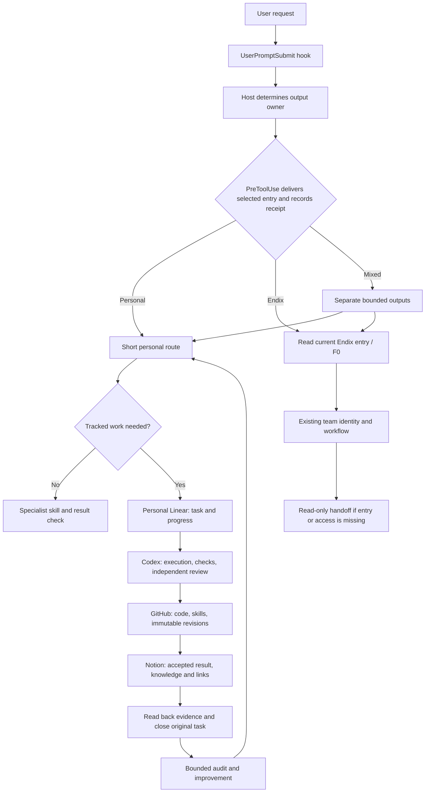

# Automatic personal and Endix entry

The user-level Codex hooks select an entry before local tool work. The host model
uses the current request and settled conversation context to choose `personal`,
`endix`, or `mixed`. There is no keyword classifier or second model call.

`UserPromptSubmit` supplies that decision contract and creates a private pending
receipt. `PreToolUse` denies supported local tools until the host submits the
exact entry command. The hook emits a short owner-specific route, records its
hash, and releases that turn. A personal route points to the installed
`harness-run` skill but does not inject its body; the host reads it only when the
task needs tracked execution. Its absence does not block ordinary personal work;
the host reports that limitation if tracked work needs it. After the hook delivers
the route, the command
prints a short receipt rather than duplicating the same text in the turn. If the
command runs before hook delivery, it retains the route-text fallback.
The receipt does not prove the model read it, or that the shell command succeeded.
Clarification and ending a voice call remain possible while entry is pending.
Ordinary answers without tools do not need a ledger or an entry command.

Managed personal runs now use Notion as the durable source of truth. Their
runner requires a saved and compared Notion summary; declared executable changes
also require GitHub readback at an immutable revision. The separate
`closeout_hook.py` Stop handler requests one recovery pass when this session has
unfinished managed tasks in the current project. It then reports unresolved
work rather than looping during an outage. The runner's Done gate remains in
force. Explicit blocked/paused tasks may be reported without claiming success.
The Stop reminder ignores runs already saved as Done: those receipts describe
their pinned revision, even when later personal source changes make a new live
status check report repair-required. Unfinished runs still require current
closeout evidence; later changes belong to a separate task or explicit audit.

## Ownership and continuity

- Personal/non-Endix outputs use relevant specialist skills directly. Substantial
  work needing saved progress, independent review or durable closeout uses the
  installed `harness-run` in addition. Reusable feedback can use the independent
  `skill-feedback` skill.
- Actual Endix outputs use the current project entry and applicable F0 procedure.
  The hook supplies source locators, not a Lighthouse stamp or permission to write.
  A missing deployment becomes a bounded handoff. Do not create a personal proxy
  task tree or alter Endix Linear, Notion, GitHub, hooks, or team rules.
  Endix team execution testing is deferred until Hyunsu's setup is ready.
- Mixed work keeps separate owners, task identities, destinations, and permissions.
  A personal overview links team records without synchronizing their status.
- A private analysis mentioning Endix can stay personal. Working directory alone
  is not ownership. The host must resolve material ambiguity before proceeding.

The diagram is the operating contract. Read the latest closeout verification
report for the observed service state; the earlier
`../audit/personal-hub-links-2026-09-24.md` remains a historical pre-repair snapshot.
New managed tasks require Notion and declared GitHub receipts. Explicit
read-only/local-only tasks use a reasoned scope exception.

## Enforcement limits

The mechanical invariant is **short entry context delivered before supported local
tool calls in a turn observed by UserPromptSubmit**. It does not prove correct
semantic classification, live project access, compliance with every later step,
or successful Linear/Notion/GitHub delivery. The existing ledger enforces its
artifact/check/review transitions; the host verifies required external receipts.
The receipt is not an authorization token or a security sandbox.

Hosted web tools and specialized tool paths may bypass local hooks. Existing turns
that predate installation and subagent-only lifecycles without UserPromptSubmit
are not newly gated. Parent agents must pass the chosen owner, entry and allowed
writes to workers. `write_stdin` does not retrigger PreToolUse for an already
approved process. Hook failure/timeout behavior is controlled by Codex; treat
runtime hook warnings as a failed control, not a successful entry.

Hooks coexist with project and plugin hooks; Codex runs matching hooks together.
This personal hook neither replaces nor disables Endix or Ponytail hooks.
Work cloud and other machines need their own available scripts, hook configuration,
trust and tests. This local installation does not activate cloud hooks.
The Stop handler only discovers the nearest project ledger from the event's cwd
and tasks owned by that event's session. Work tracked in another folder and
subagent-owned tasks remain the coordinator's responsibility. It does not inspect
remote services or infer that an untracked conversation should have made a task.

## Maintenance and rollback

Source: `entry_hook.py`; focused check: `python3 -B harness/test_entry_hook.py`
from the repository root. Deploy a reviewed copy under
`~/.codex/hooks/harness-entry-<sha256>.py`, then configure only its
`UserPromptSubmit` and `PreToolUse` command handlers in `~/.codex/hooks.json`.
Keep other hooks intact. Review and trust the exact new definitions via Codex's
hook interface before claiming activation. The content-addressed script path
ensures a code update changes the hook definition that is reviewed.

Open a fresh local task for verification. Inspect actual `hooks/list` metadata,
the new run's entry command and its private receipt. Do not infer activation from
configuration alone. Do not use a hook-trust bypass to validate the installation.

For rollback, disable only the two personal entry handlers in `/hooks`, or remove
only handlers whose command names the installed `harness-entry-<sha256>.py`.
Preserve subsequently added handlers, plugin hooks and unrelated configuration.
Do not blindly restore an old whole-config backup over newer changes.
To disable the closeout reminder, remove/disable only the Stop handler whose
command names `harness-closeout-<sha256>.py`. Disabling a reminder does not waive
the managed runner's completion checks. Preserve pinned releases for old tasks.

Receipts are stored with private filesystem permissions under
`~/.local/share/agent-harness/entry-state/`. They contain a hash-derived turn key,
timestamps, chosen route and entry hash; no prompt, credentials or document body.
They are not a task queue. Retention is manual; removing old receipts does not
delete task artifacts, and active-turn receipts must be preserved.

Primary platform reference: [Codex hooks](https://learn.chatgpt.com/docs/hooks).

## Runtime gates after entry

The selected personal entry leads to the installed harness-run skill. New tracked
runs configure four cooperative runner gates: `before-write`, `after-write`,
`before-delegate`, and the automatic `complete` gate. See **Four runtime hooks**
in `README.md`. The host calls the first three at the real service/delegation
boundaries, forwards contracts and supplies actual fetched evidence. They are
not additional global Codex handlers; local entry selection alone does not prove
these gates ran. Existing global hook registration and trust remain unchanged.
